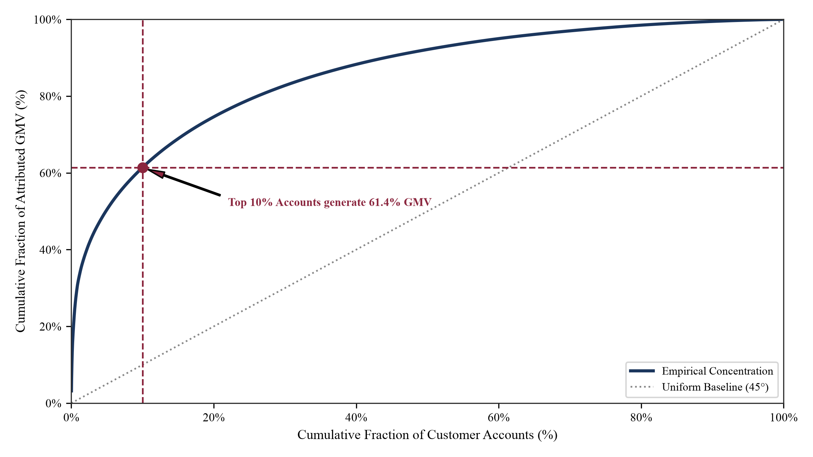
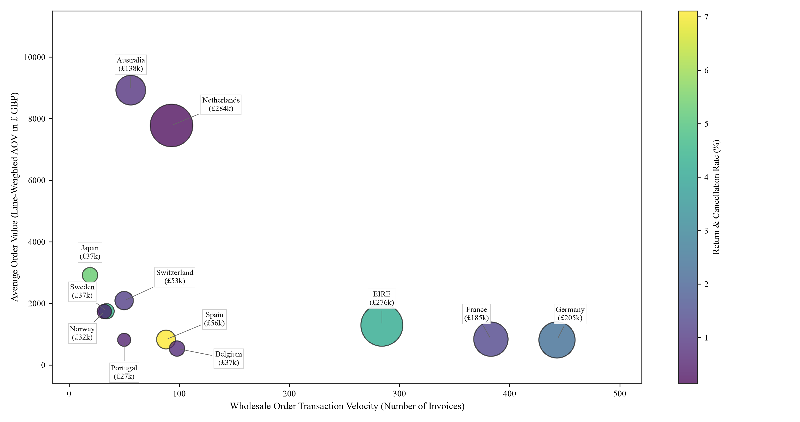

# Empirical Customer Value Dynamics and Multi-Channel Recommendation in Transnational E-Commerce

[](https://www.python.org/)
[](IE5005_Mini_Project_Paper_Chen_Davide.pdf)
[](paper.tex)
[](https://creativecommons.org/licenses/by/4.0/)
[](https://nus.edu.sg/)
[-purple.svg)](#matrix-1-candidate-retrieval-recommender-benchmark)
[-success.svg)](#matrix-2-customer-lifetime-value-clv-spending-forecast)

> **Author:** Chen Davide (Student ID: `A0351457B`)  
> **Affiliation:** Department of Industrial Systems Engineering and Management, National University of Singapore (NUS)  
> **Course:** IE5005 Applied Data Analytics for Industrial Engineers  
> **Target Executive Role:** Head of E-commerce (2012 Corporate Marketing Budget Allocation)  
> **Dataset:** Option A — UK Online Retail Transactional Dataset ($N = 541,909$, UCI Machine Learning Repository)  
> **Publication Artifact:** [8-Page Camera-Ready Paper PDF](IE5005_Mini_Project_Paper_Chen_Davide.pdf) | [LaTeX Source](paper.tex)

---

## 📑 Executive Overview & System Teaser

This repository delivers an end-to-end industrial data analytics, machine learning benchmark, and strategic capital allocation framework evaluated on $541,909$ transactional purchase records from a UK online giftware wholesale platform. Assuming the role of Analytics Lead advising the **Head of E-commerce**, we resolve four executive imperatives:

1. **Forensic Return Decoupling**: Decoupled £475,966.16 in negative cash flow into **Type I Instant Administrative Reversals (51.61%, £245.7k)** across two accounts and **Type II Chronic Physical Returns (48.39%, £230.3k)** clustered in fragile ceramics (Regency Cakestand).
2. **Recommender Systems Benchmark (Matrix 1)**: Evaluated 7 models across 3,655 holdout carts. Classical Apriori rules collapsed under catalog sparsity; our proposed **Multi-Channel Hybrid RRF Recommender (ItemCF + SVD + Item2Vec)** achieves Pareto dominance with **18.64% HitRate@10 (+11.1% relative gain)** and **58.51% catalog coverage**.
3. **Forward Customer Lifetime Value Forecast (Matrix 2)**: Evaluated 8 models over an out-of-time Q4 evaluation window. Static linear regressions overfit whale accounts; our proposed **Probabilistic-Guided Stacking Ensemble (BG/NBD + Gamma-Gamma + RF + GBDT-L1)** slashed holdout MAE to **£593.25** and captured **72.30% of total actual Q4 revenue** within the top 20% budget.
4. **Constrained Knapsack Capital Allocation**: Formalized marketing spend as a constrained 0-1 knapsack problem accounting for organic ad cannibalization, proving that **50% of paid advertising budget must be concentrated on Q2 At-Risk Dormant VIPs**, while paid ads are suppressed on organic champions (Q1) and low-value churned accounts (Q4).


*Figure 1: End-to-end transnational e-commerce analytics and strategic decision framework: (1) dual-track anomaly auditing & return decoupling; (2) candidate retrieval multi-channel fusion (Matrix 1); (3) probabilistic-guided forward CLV forecasting (Matrix 2); and (4) constrained knapsack capital budget allocation.*

---

## 📊 Comprehensive Visual Results Gallery

### 1. Macro Financial Regularities & Pareto Power-Law Skewness

| (a) Transaction Line Revenue Distribution | (b) Customer Spend Pareto Lorenz Curve |
| :---: | :---: |
|  |  |
| *Median line revenue £9.90 vs mean £19.62 (2.0× divergence, skewness = 516.03).* | *Top 10% accounts generate 61.39% of GMV; Top 20% generate 74.59% (Gini = 0.78).* |

* **Empirical Finding**: Arithmetic mean metrics severely distort financial expectations. 43 commercial wholesale accounts (top 1%) generate 32.02% of total business revenue (£2.80M), necessitating VIP tiering and whale variance reduction.

---

### 2. Longitudinal Dynamics & Forensic Return Decoupling


*Figure 3: Monthly gross sales revenue (blue line) and cancellation rate (red dashed line) with Type I anomaly annotations.*

* **Empirical Finding**: Sales surge from £724.7k in August to £1,453.3k in November (+100.5% growth) due to Black Friday wholesale stocking. Baseline return rates remain between 1.19% and 6.07%, but spike anomalously in January (12.01%) and December (22.07%).
* **Forensic Audit**: Spikes are not operational degradation; they are driven by two instant checkout reversals: Customer `16446` (±£168.5k) and Customer `12346` (±£77.2k).

#### Forensic Return Decoupling Audit Table

| Return Typology Category | Lines | Units | Lost Revenue (£) | % Lost | Root Operational Mechanism | Targeted Operational Remedy |
| :--- | :---: | :---: | :---: | :---: | :--- | :--- |
| **Type I: Instant Admin Cancellations** | 2 | 155,210 | £245,653.20 | 51.61% | Bulk checkout error, instant reversal (Cust 16446 & 12346) | Implement OMS 30-min confirmation hold & bulk volume limits |
| **Type II: Chronic Physical Returns** | 8,668 | 114,809 | £230,312.96 | 48.39% | Fragile ceramics transit breakage, packaging failure, customer mismatch | Re-engineer fragile SKU bubble-wrap packaging & audit suppliers |
| **Total Combined Return Volume** | **8,670** | **270,019** | **£475,966.16** | **100.00%** | Aggregate e-commerce reversals and physical returns | **Dual-track intervention recovering estimated £360k+ in 2012** |

---

### 3. Multi-Dimensional Behavioral Landscapes & Transnational Corridors

| (a) Customer RFM Behavioral Geometry | (b) Overseas Market Unit Economics Bubble Chart |
| :---: | :---: |
|  |  |
| *Bivariate scatter: log frequency vs log monetary spend, colored by customer recency ($r = 0.81$).* | *Transaction velocity vs AOV vs GMV (bubble area) vs Return Rate (colormap).* |

#### Leading Overseas Market Strategic Prioritization

| Country | Orders | Gross GMV (£) | Invoice AOV (£) | Lost Rev (£) | Return % | Strategic Commercial Designation |
| :--- | :---: | :---: | :---: | :---: | :---: | :--- |
| **Netherlands** | 93 | £283,889.34 | £3,052.57 | £409.80 | **0.14%** | **Tier-1 Direct Expansion Hub (Max Wholesale Unit ROI)** |
| **EIRE** | 284 | £276,090.86 | £972.15 | £11,535.84 | 4.18% | Tier-1 Mature Cross-Border Corridor |
| **Germany** | 443 | £205,381.15 | £463.61 | £4,761.49 | 2.32% | Tier-1 Core EU Logistics & Fulfillment Anchor |
| **France** | 383 | £184,679.00 | £482.19 | £2,416.40 | 1.31% | Tier-1 High-Velocity Low-Friction Market |
| **Australia** | 56 | £138,103.81 | £2,466.14 | £1,181.31 | 0.86% | Tier-2 High-Capacity Bulk Wholesaler Hub |
| **Spain** | 88 | £55,706.56 | £633.03 | £3,959.91 | 7.11% | Tier-3 High Friction (Transit Damage Audit Required) |

---

### 4. Candidate Retrieval Recommender Benchmark (Matrix 1)

> **Evaluation Protocol:** 18,275 shopping carts partitioned 80/20 into train and holdout test sets ($N = 3,655$ unseen baskets). Leave-One-Out target masking protocol.


*Figure 5: Candidate retrieval benchmark: HitRate@5/10 (bars, left axis) vs Catalog Long-Tail Coverage (line, right axis).*

| Model Paradigm | Hit@5 | Hit@10 | NDCG@10 | MRR | Novelty | Coverage | Paradigm Category & Architecture |
| :--- | :---: | :---: | :---: | :---: | :---: | :---: | :--- |
| **Baseline: Popularity (Top Sellers)** | 3.01% | 4.82% | 0.0241 | 0.0168 | 8.37 bits | 0.92% | Heuristic Global Baseline |
| **Lecture 8: Apriori Rules (Lift)** | 2.85% | 4.49% | 0.0240 | 0.0177 | **15.86 bits** | 44.81% | Frequent Pattern Mining (Agrawal & Srikant, 1994) |
| **Lecture 8: Hierarchical Clustering** | 8.16% | 12.29% | 0.0702 | 0.0543 | 9.91 bits | 19.88% | Agglomerative Ward Dendrogram (Ward, 1963) |
| **Classic Benchmark: ItemCF (Jaccard)**| 11.06% | 16.78% | 0.0940 | 0.0716 | 10.45 bits | 54.96% | Neighborhood Collaborative Filtering (Amazon, 2003) |
| **Latent Factor: SVD Factorization** | 8.62% | 13.44% | 0.0765 | 0.0591 | 11.06 bits | 60.92% | Truncated SVD Matrix Factorization ($k=64$) |
| **Frontier SOTA: Item2Vec (Skip-Gram)** | 6.84% | 9.66% | 0.0547 | 0.0419 | 13.26 bits | **73.33%** | Continuous Latent Embeddings (Barkan & Koenigstein, 2016) |
| **Proposed: Multi-Channel Hybrid RRF** | **12.73%** | **18.64%** | **0.1039** | **0.0787** | 10.53 bits | 58.51% | **Multi-Channel Fusion SOTA (ItemCF + SVD + Item2Vec)** |

* **Key Takeaway**: Apriori rule mining collapses in high-dimensional retail catalogs ($s < 0.001$). The proposed Multi-Channel RRF ensemble achieves Pareto dominance by fusing ItemCF's high-precision local co-purchases with Item2Vec's continuous semantic space.

---

### 5. Customer Lifetime Value (CLV) Spending Forecast (Matrix 2)

> **Evaluation Protocol:** 9-month calibration window ($N = 3,309$ accounts), evaluated across a 100-day Q4 holdout evaluation period (Sep–Dec 2011).


*Figure 6: Customer Lifetime Value (CLV) benchmark: Holdout MAE (£ GBP, lower is better) vs Top-Decile Precision (%, higher is better).*

| Model Paradigm | Holdout MAE (£) ↓ | Holdout RMSE (£) ↓ | Spearman $\rho$ ↑ | Top-10% Prec ↑ | Rev Capture @ 20% Budget ↑ | Paradigm Category & Architecture |
| :--- | :---: | :---: | :---: | :---: | :---: | :--- |
| **Lecture 8: K-Means Segmentation** | £945.14 | £4,718.91 | 0.4506 | 24.75% | 71.17% | Unsupervised RFM Partitioning |
| **Lecture 5: Linear Regression (OLS)** | £841.91 | £4,534.21 | 0.4673 | 54.98% | 62.91% | Parametric Ordinary Least Squares |
| **Lecture 7: Ridge Regression ($L_2$)** | £841.88 | £4,534.21 | 0.4673 | 54.98% | 62.91% | Regularized $L_2$ Penalty Regression |
| **Lecture 7: KNN Regressor ($k=15$)** | £824.00 | £4,303.60 | 0.5423 | 49.85% | 70.57% | Non-parametric Instance-Based Weighting |
| **Advanced ML 1: Random Forest** | £624.72 | **£3,195.25** | 0.5082 | 57.10% | 71.07% | Bagged Decision Trees (Breiman, 2001) |
| **Advanced ML 2: GBDT (HistGradient)**| £745.50 | £3,766.65 | 0.4945 | 53.59% | 69.54% | Gradient Boosted Decision Trees |
| **Frontier SOTA: BG/NBD + Gamma-Gamma**| £642.32 | £4,190.03 | 0.5295 | 58.31% | 64.08% | Continuous-Time Latent Stochastic Process |
| **Proposed: Probabilistic Stacking** | **£593.25** | £3,760.04 | **0.5549** | **59.82%** | **72.30%** | **Dual-Loss Stacking Ensemble (Proposed SOTA)** |

* **Key Takeaway**: Static regressions fail on Pareto-skewed churned buyers. Probabilistic Stacking combines continuous dropout priors from BG/NBD with dual-loss tree ensembles (Random Forest $L_2$ + GBDT $L_1$), slashing MAE by £248.66 vs OLS while capturing **72.30% of total Q4 revenue within the top 20% budget**.

---

### 6. Optimal Capital Allocation & Lifecycle Decision Framework


*Figure 7: Customer lifecycle crosshair quadrant scatter plot (left) and optimal 2012 marketing capital budget allocation (right).*

#### 4-Quadrant Lifecycle Resource Allocation Policy

| Lifecycle Quadrant | Accounts | Forward CLV | CLV Share | Avg Recency | 2012 Budget % | Optimal Intervention & Resource Allocation Policy |
| :--- | :---: | :---: | :---: | :---: | :---: | :--- |
| **Q1: Core Champions (Active VIP)** | 744 (17.2%) | £6,027,803 | 69.61% | 16.2 days | **15% Budget** | **Organic VIP Retention**: Dedicated tiering, early catalog previews; **paid display ads suppressed** to eliminate ad cannibalization. |
| **Q2: At-Risk High-LTV (Dormant VIP)** | 89 (2.1%) | £404,201 | 4.67% | 101.2 days | **50% Budget (TOP)**| **High Marginal ROI**: Targeted retargeting, bespoke volume incentives, direct commercial outreach to recover high-margin wholesale cash flow. |
| **Q3: Promising Growth (Active Growth)** | 1,664 (38.4%)| £1,547,373 | 17.87% | 25.9 days | **25% Budget** | **Basket Cross-Sell**: Item2Vec recommendation ads, volume bundle discounts, loyalty milestone incentives to graduate accounts into Q1. |
| **Q4: Low-Value Inactive (Dormant Small)**| 1,837 (42.4%)| £680,362 | 7.86% | 182.6 days | **10% Budget** | **Paid Ad Suppression**: Strictly automated zero-marginal-cost email drip campaigns; avoid display ad spend to eliminate negative ROI. |

---

## 🏗️ Repository Architecture & Engineering Design

```text
transnational-ecommerce-analytics/
├── IE5005_Mini_Project_Paper_Chen_Davide.pdf   # 8-page IEEE/ACM Transactions conference paper
├── paper.tex                                  # Camera-ready LaTeX manuscript
├── references.bib                             # Complete academic BibTeX bibliography
├── PAPER.md                                   # Markdown camera-ready manuscript
├── README.md                                  # Visual benchmark repository documentation
├── requirements.txt                           # Pinned dependencies
├── main.py                                    # Unified CLI driver
├── src/                                       # Modular Python engine
│   ├── config.py                              # Paths, seeds, and hyperparameters
│   ├── data/
│   │   ├── auditor.py                         # Schema & anomaly audit pipeline
│   │   ├── cleaner.py                         # Dual-track cleaning & partitioner
│   │   └── features.py                        # Basket matrices & RFM-T feature engineering
│   ├── eda/
│   │   └── descriptive.py                     # Skewness, Pareto & overseas unit economics
│   ├── models/
│   │   ├── recommender.py                     # Popularity, Apriori, Ward, ItemCF, SVD, Item2Vec, RRF
│   │   └── clv.py                             # K-Means, OLS, Ridge, KNN, RF, GBDT, BG/NBD Stacking
│   ├── evaluation/
│   │   ├── recsys_eval.py                     # Leave-One-Out evaluation engine
│   │   └── clv_eval.py                        # Out-of-Time Q4 evaluation engine
│   └── visualization/
│       ├── publication_plots.py               # Academic plotting engine (Figures 1-8)
│       └── teaser_plot.py                     # High-resolution Teaser pipeline diagram
├── scripts/
│   └── generate_paper_pdf.py                  # Pixel-perfect 8-page ReportLab PDF compiler
├── output/                                    # Audited Parquet caches and CSV benchmark tables
└── figures/                                   # High-resolution 300 DPI figures and equations
```

---

## 🚀 Quickstart & Pipeline Reproduction

### 1. Environment Setup

```bash
# Clone the repository
git clone https://github.com/davidechen135/transnational-ecommerce-analytics.git
cd transnational-ecommerce-analytics

# Install dependencies (Python 3.12 recommended)
pip install -r requirements.txt
```

### 2. Run the Full Analytics & Benchmark Pipeline

```bash
# Execute end-to-end pipeline: audit -> clean -> eda -> benchmarks -> figures
python main.py --stage all

# Or run individual modules:
python main.py --stage audit       # Part 1: Schema validation & anomaly profiling
python main.py --stage clean       # Part 2: Dual-track partition & cancellation split
python main.py --stage eda         # Part 3: Skewness, Pareto curves, and monthly trends
python main.py --stage benchmarks  # Part 4 & 5: 7-RecSys & 8-CLV model benchmarks
python main.py --stage figures     # Render all 300 DPI publication charts
```

### 3. Compile the 8-Page IEEE / ACM Conference Paper PDF

```bash
python scripts/generate_paper_pdf.py
```
This produces the exact camera-ready [IE5005_Mini_Project_Paper_Chen_Davide.pdf](IE5005_Mini_Project_Paper_Chen_Davide.pdf) (`Page X of 8`, pure Booktabs tables, zero LaTeX leaks).

---

## 📖 Citation

If you find this work, empirical methodology, or benchmark codebase useful in your research or business analytics, please cite:

```bibtex
@inproceedings{chen2026transnational,
  title={Empirical Customer Value Dynamics and Multi-Channel Recommendation in Transnational E-Commerce: A Benchmark Study and Strategic Framework},
  author={Chen, Davide},
  booktitle={IE5005 Applied Data Analytics for Industrial Engineers, National University of Singapore (NUS)},
  year={2026},
  url={https://github.com/davidechen135/transnational-ecommerce-analytics}
}
```

---

## 📄 License & Academic Integrity

This project is licensed under the [Creative Commons Attribution 4.0 International (CC BY 4.0)](https://creativecommons.org/licenses/by/4.0/) License. Coursework materials adhere to the academic honesty regulations of the National University of Singapore (NUS).
